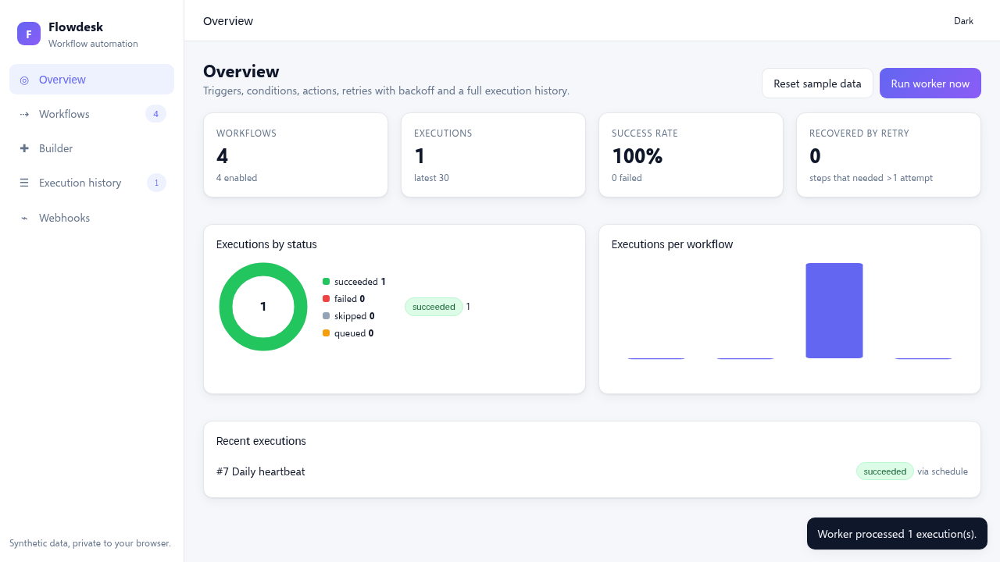
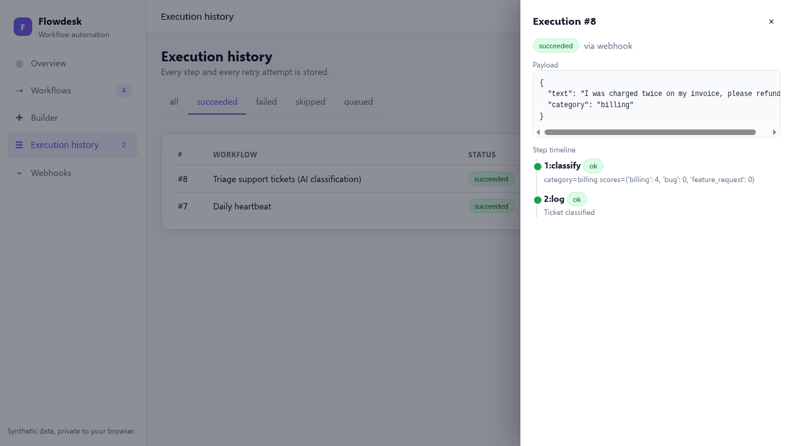
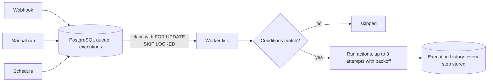

# Smart Workflow Automation Platform

[](https://github.com/ZeyadMohamed00/smart-workflow-automation/actions/workflows/ci.yml)

Define workflows with a trigger (webhook, schedule, manual), conditions, and actions (including AI-style text classification). Executions are queued in PostgreSQL, run by a worker with retry and exponential backoff, and every step is stored in an execution history. FastAPI + PostgreSQL + React/TypeScript.

**Live app (free tier):** https://wf-web-lac.vercel.app  (click "Send test webhook", then look at Execution history)
API docs: https://wf-api-gamma.vercel.app/docs




Pages: Overview, Workflows (editable JSON test payload), Builder (templates, multiple conditions, ordered actions), Execution history (filters, search, step timeline), Webhooks (copy curl).

## System overview


**Tech stack:** FastAPI, PostgreSQL, React, TypeScript, Pytest, Vitest, Docker.

## How it works
```
webhook POST /hooks/{token} | manual run | schedule due (worker tick)
   -> INSERT execution(status=queued)
worker tick: claim queued rows (SELECT ... FOR UPDATE SKIP LOCKED)
   -> conditions match? no -> skipped
   -> actions in order; each action retried up to 3 times with 0.2s, 0.4s backoff
   -> succeeded | failed (error + every attempt stored in steps)
```
- Conditions: `eq, neq, gt, lt, contains` on payload fields (a missing field or a bad number means "no match").
- Actions: `classify` (billing / bug / feature_request / other), `set_field`, `log`, `notify` (records only), `flaky` (a deliberately unreliable dependency to demonstrate retries).
- Each visitor gets private sample workflows; the UI has a small builder for new ones.

## Honest status (differences from the plan)
- **No Celery and no Redis.** They cannot run on a free serverless host. The queue is a Postgres table and the worker is `engine.tick()`. `FOR UPDATE SKIP LOCKED` makes it safe to run many workers, so swapping in Celery workers later is a small change, but I have **not** done or tested that.
- **The worker runs when triggered**: by the UI button (the "Send test webhook" button also runs a tick), by `/worker/tick`, and by a Vercel Cron job (`/cron/tick`, once a day on the free plan, protected by `CRON_SECRET`). So schedules fire at most daily on the live demo, not on a real minute-level clock. A dedicated worker process (`python -c "from wf.engine import tick"` in a loop) would fix that, and is not deployed.
- **"AI classification" is a keyword-score classifier**, not an LLM. No API key was available. It is labeled as such in the UI. It is a simple heuristic and will mislabel anything outside its keyword lists.
- The `notify` action only records a line; this app sends no emails or messages. There is no outbound HTTP action (deliberate, to avoid SSRF on a public app).
- Webhook URLs contain a random token; there is no signature verification or per-user login. Visitors are separated by a browser id only.
- Docker files are not verified (no Docker here). GitHub Actions CI runs the tests on every push (`.github/workflows/ci.yml`).
- Tests: 13 backend (real PostgreSQL, covering conditions, classifier, webhook-to-history, skip/match, retry then success, permanent failure after 3 attempts, schedule once per interval, validation, isolation, cron secret) and 2 frontend. No load testing was done.

## Run
```bash
pip install -r requirements.txt pgserver
DATABASE_URL=postgresql+psycopg2://user:pw@host/db uvicorn wf.main:app
cd frontend && npm i && npm run dev
pytest
```

## 5 things to understand to explain this project
1. **Queue in the database**: enqueue = insert a row; workers claim rows with `FOR UPDATE SKIP LOCKED`, so two workers never run the same execution.
2. **Retries with exponential backoff**: transient failures are retried (0.2s, 0.4s), a permanent failure stops the workflow and keeps every attempt in the history.
3. **Conditions before actions**: a trigger that does not match is recorded as `skipped`, not silently dropped.
4. **Triggers**: webhooks enqueue immediately; schedules are enqueued by the worker tick when due, so timing depends on how often the worker runs.
5. **Honest limits**: no Celery/Redis, keyword "AI", daily cron on the free plan. I know exactly what would change in production: a real worker process, a real broker, an LLM classifier, real queue-backed workers.

## Accounts and persistence
- **Real accounts:** `POST /auth/register`, `POST /auth/login`, `GET /auth/me`. Passwords are salted PBKDF2-SHA256 hashes; sessions are signed JWTs (7 days) sent as `Authorization: Bearer`. Set `JWT_SECRET` in production; if it is unset, a secret is derived from `DATABASE_URL`.
- **Persistence:** a signed-in user's data is stored in PostgreSQL under their own account key (`user:<id>`) and is only reachable with their token. New accounts start empty.
- **Guest session:** without logging in, "Explore without signing up" uses an anonymous browser id. Guest ids can never collide with or impersonate an account.
- Tests: `tests/test_auth.py` (register, login, wrong or weak password, duplicate email, bad token, isolation) and `frontend/src/auth.test.tsx`.
- Login is throttled: 5 wrong passwords per email in 5 minutes returns `429` with `Retry-After` (`LOGIN_MAX_FAILS`, `LOGIN_FAIL_WINDOW_S`). The counter lives in process memory, so each serverless instance counts separately; use a shared limiter for hard guarantees. With `APP_ENV=production` a missing `JWT_SECRET` stops the app at startup.
- Not built: email verification, password reset and refresh tokens (listed as next steps).

## Database migrations

Schema changes are versioned with Alembic (`migrations/`, baseline `0001`). Point `DATABASE_URL` at the database and run `alembic upgrade head`. The baseline was generated from the models and checked by running upgrade, downgrade and upgrade again on SQLite; I did not run it against a fresh PostgreSQL instance here. The running app still creates missing tables on start.

## Signed webhooks

Webhook calls can be signed so a leaked URL alone is not enough to trigger a workflow. Each workflow has its own signing key (shown as `webhook_signing_key` in the workflow JSON, derived from the server secret and the workflow token). Sign `"<unix timestamp>.<raw body>"` with HMAC-SHA256:

```bash
TS=$(date +%s); BODY='{"text":"charged twice"}'
SIG=$(printf '%s.%s' "$TS" "$BODY" | openssl dgst -sha256 -hmac "$SIGNING_KEY" -hex | sed 's/^.* //')
curl -X POST "$API/hooks/$TOKEN" -H "X-Webhook-Timestamp: $TS" -H "X-Webhook-Signature: sha256=$SIG" -d "$BODY"
```

A bad signature or a timestamp older than 5 minutes returns `401` (replay protection). Unsigned calls still work by default so the test button works; set `WEBHOOK_REQUIRE_SIGNATURE=1` to reject them. Covered by three tests in `tests/test_wf.py`. Code: `wf/signing.py`.
